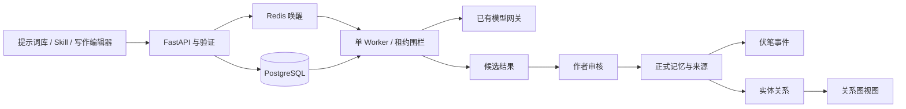

# 三参考项目功能整合架构

设计日期：2026-11-02（Asia/Shanghai）。整体设计由 `/root/novel_arch_astra`，即 `architect / gpt-6-astra` 完成；主代理负责集成和实际验收。用户已授权设计后直接开发并部署。本文记录设计基线；实际执行结果见根 `CHANGELOG.md` 和 `DEPLOYMENT.md`，不把设计视为已验收。

## 方向与来源核对

保留现有 React、FastAPI、PostgreSQL、单 Worker 和 Redis 唤醒机制，在一个小说工作台里实现功能。参考项目各自的后端、账户和数据存储不拼接进主应用。四个体验项目的容器及专用网络已经退出，源码、镜像和独立数据卷保留。CLI 不再参与整合。

| 参考 | 借鉴的行为 | 需要纠正的理解 |
| --- | --- | --- |
| MuMu | 分类提示词、默认模板与自定义、预览、版本化、导入导出、独立 Skill 栏目 | 它的 Skill 主要是 Markdown 与参考资料驱动的模型对话，不能直接称为任意工具执行器 |
| Lite | 写作任务预设、小说范围、变量预览、导入冲突预检 | Prompt Studio 是提示词系统，不等于 Skill 引擎；题材和任务阶段应分开分类 |
| Show Me The Story | 事实原文证据、修订失效、伏笔生命周期、关系可视化 | 原关系图主要来自人工维护的实体关系；图谱不是自动理解全文的事实来源 |

本轮按行为独立实现，自写初始模板。MuMu 为 GPL-3.0；Lite 固定版本未发现 LICENSE；Story 为 MIT。不把公开可读等同于无条件复制许可，不直接搬入 MuMu/Lite 的代码和提示词正文。来源版本保存在 `deploy/reference-lab/sources.lock.json`。

## 信息结构

保留正文、大纲、任务、设置、用量。新增独立的提示词库和 Skill；故事资料分成记忆、伏笔、关系图。

| 对象 | 内容 | 能力边界 |
| --- | --- | --- |
| 提示词 | 可分类、带变量、带版本的文本模板 | 不执行代码，不授予工具权限，不覆盖服务端输出协议 |
| Skill | 有输入、步骤、输出和调用上限的操作入口 | 本轮映射已有 outline/write/rewrite/audit/confirm 五种 Job，无 Shell、MCP 或任意代码 |
| 正式记忆 | 已审核的正文事实与单独标识的作者设定 | 正文事实有章节、revision、原句证据；作者计划不冒充已经发生的事实 |
| 伏笔 | 计划及埋设、推进、回收、放弃的事件 | 事件引用正式记忆或明确标为作者登记；历史事件追加，不静默改写 |
| 关系图 | 人物、地点、组织、物件及其关系的投影 | 与关系列表共用记录，带出处；不维护第二套独立的事实 |

提示词按创作规划、正文创作、文字加工、审读分析分类；玄幻、悬疑等作为可多选题材标签。模板可为全局或仅当前小说。系统模板保持可恢复，用户通过另存自定义和历史修订调整。

## 数据边界

新增五张表：

- `PromptTemplate`：名称、任务类型、分类、题材标签、全局/小说范围、启用状态、当前版本与来源说明。
- `PromptRevision`：不可覆盖的模板正文版本，`template_id + revision` 唯一。
- `StoryEntity`：小说内的实体、类别、别名、描述与修订号。
- `StoryRelation`：源实体、目标实体、关系、作者/正文依据、所引 Memory 与修订号。
- `Foreshadow`：标题、描述、目标章节、追加式事件列表与修订号。

扩展 Memory：`source_revision`、`evidence_quote`、`provenance`、`visibility`、`known_by_entity_ids`、行修订号。保留既有 `kind/content/source_chapter_id/stale`。

Memory 的 `history` 保存修改前固定字段的非递归快照；关系和伏笔事件冻结 `memory_revision`，显示证据时解析对应历史版本。普通关系备注修改不能自动恢复失效来源；相同来源的新版本需要明确复核后再采用。

扩展 Novel 的 `context_revision`，知识和作者设定修改时递增。Job 冻结模板版本、正文、来源章节版本和上下文版本；增加数据库约束的幂等 key 与请求指纹。同 key 同请求返回原任务，不同请求拒绝，不能靠内存去重。

旧记忆标为 legacy，不伪造引文或来源修订号；在列表中保留供复核，不自动成为已核验的证据关系。引用中的记忆删除采用失效处理，不能留下看似有效的悬空关系。实体被关系引用时拒绝删除。

## 核心流程

### 提示词与 Skill

模板只允许安全的 `{{title}}`、`{{genre}}`、`{{style}}`、`{{instructions}}` 变量，不使用 eval、函数调用或文件访问。预览不调用模型。导入先 dry-run，报告冲突；实际导入不静默覆盖已有内容。

Skill 映射已有任务，显示必要输入及调用数量。章节写作仍为一次生成加一次审稿，批量最多 20 章。任务创建时冻结模板正文及版本，后续编辑模板不能改变已排队或重试任务。模型调用不能承诺恰好一次，失败时可能已经计费。

### 记忆提取与采纳

1. 创建 confirm 任务，冻结章节 revision、正文 hash、小说上下文版本和模板版本。
2. Worker 提取候选并校验证据，保存到 `Job.result.memory_candidates`；此时章节未定稿，正式记忆不变。
3. 作者查看原句，修改、勾选候选，明确点击采纳。
4. 在一个事务内检查任务、来源版本、前文失效状态和上下文版本，验证引文确实存在于对应正文。
5. 旧来源记忆标失效并保留；写入采纳事实、确认章节、清除 dirty、标记任务 applied。
6. 重复相同采纳不重复写入；不同内容再次采纳或旧版本候选返回冲突。

编辑旧章节仍使本章及后续记忆失效。关联的关系和伏笔事件派生为失效/待复核，不自动连接到文本相似的新事实。

### 伏笔与图谱

伏笔事件包含稳定 ID、状态、说明、依据类型与 Memory ID。无事件为 planned；有效事件计算当前状态，失效事件仍保留显示但不维持已回收状态。作者登记和正文证据须显著区分。

图谱和关系列表共用实体/关系表。默认只展示有效关系，可单独查看失效记录；截止章过滤排除未来章节证据。本轮不实现从全书自动抽取所有人物关系，也不引入图数据库。

## 时间、知情与上下文

章节顺序表示信息揭示顺序，不等同于故事世界的绝对时间。倒叙时间先保留为描述，不假称完整时间推理。

`visibility` 的 unknown 不等于公开。本轮采取保守的上下文筛选，人物知情字段不应被宣传为完整的 POV 防泄漏系统。作者秘密和伏笔计划不自动当作角色已知事实。

继续保留 24,000 字符上下文和 48,000 字符总请求上限，它们不是 token 精确配额。正式事实整条纳入或舍弃，不能截掉否定词后当作完整事实。冲突需作者复核，不以“较新来源”自动覆盖旧事实。

## 接口与代码模块

提示词：`/api/prompts`、`/{id}`、`/{id}/versions`、`/{id}/preview`、`/import`、`/export`。静态导入导出路由必须在动态 ID 路由之前。

Skill：`GET /api/skills`，运行仍通过现有 `/api/novels/{id}/jobs`，新增可选 `skill_id/prompt_template_id/idempotency_key`。

记忆采纳：`POST /api/jobs/{id}/apply-memory`，正文 `{expected_revision, memories}`。候选保存在 Job，不另建候选任务系统。

故事资料：小说内 `/entities`、`/relations`、`/foreshadows` 的列表/创建，以及相应 ID 修改/删除接口；`/graph?before_chapter=N&include_stale=false` 返回 `{nodes,edges,cutoff}`。

后端按模板、Skill、知识、迁移拆模块。前端将新增界面从 App.tsx 拆出，保留原编辑器的未保存状态、选段替换、历史版本、复制回退和 TXT/Markdown 导出。

## 升级与验收

先完成活动旧任务并停止旧 API/Worker，再显式迁移；启动检查 schema，不让 API 与 Worker 同时升级旧库。新增字段/表，不删除旧正文。迁移前在 D 盘保存并校验一致性数据库备份，保留回滚恢复路径。

实际验收包括模板版本和快照、未知变量和导入冲突、五种 Skill 的真实 Job 映射、提取不自动确认、过期候选拒绝、采纳幂等、跨书引用拒绝、并发 revision、章节修订后的关系和伏笔失效、图谱截止章过滤、复制与导出、重建后的持久化。PostgreSQL 的锁与唯一约束需要真实数据库验证；SQLite 单元测试不替代该项。

自动关系抽取、向量检索、通用 Skill 编排、完整人物 POV 推理和百万字质量验证不属于本轮交付。
